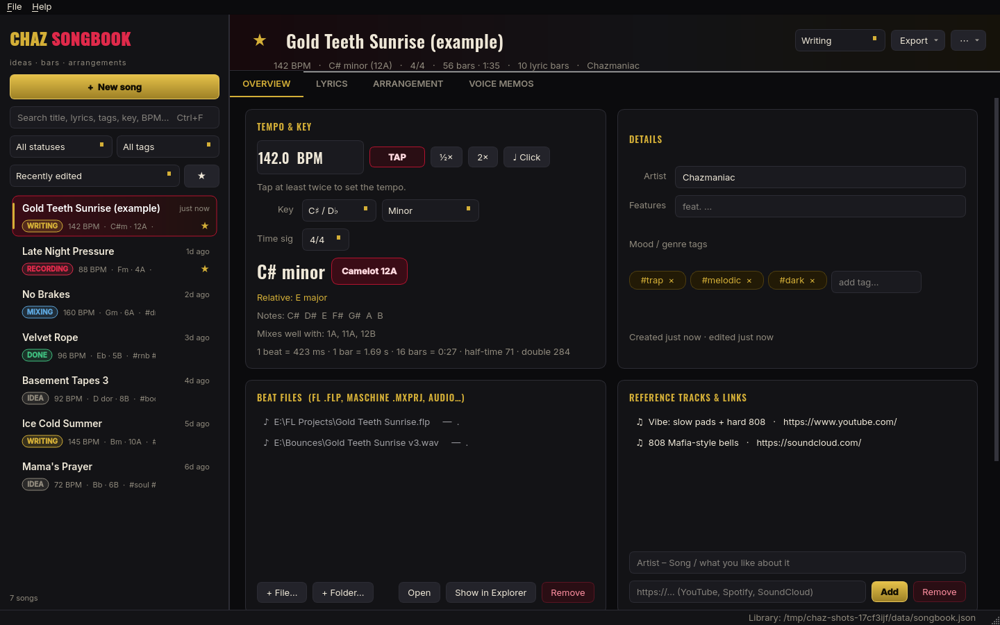
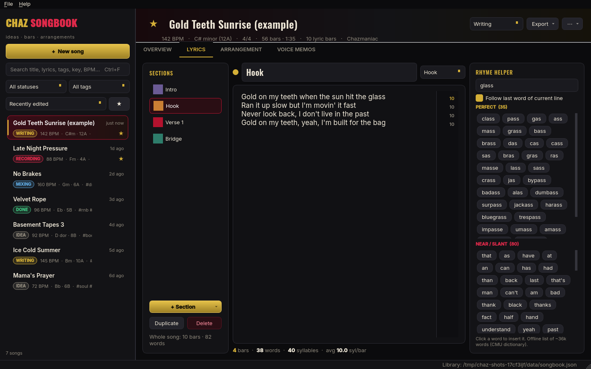
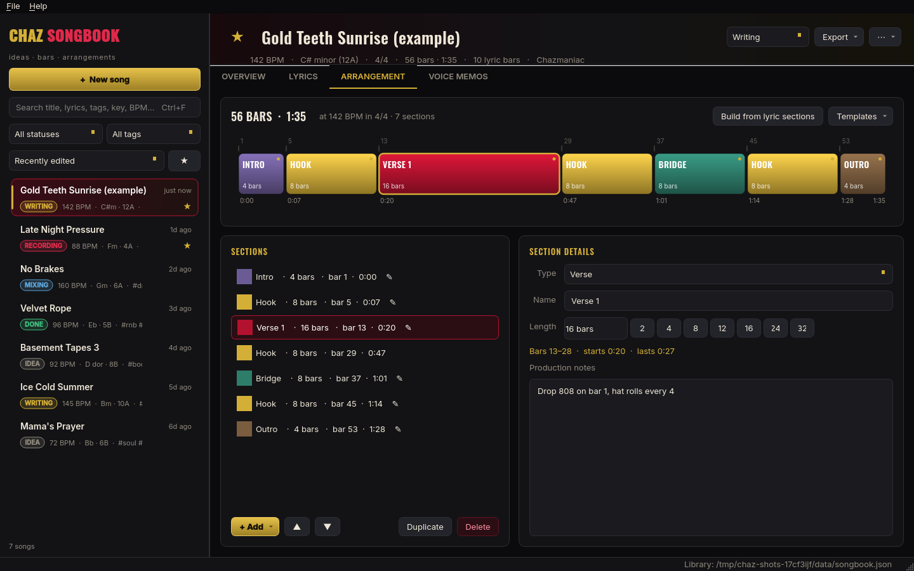
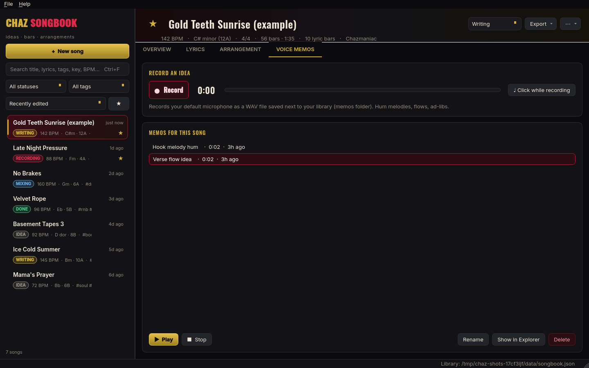

# Chaz SongBook

A dark, black-gold-crimson desktop notebook for catching song ideas the second they hit:
**BPM & key, lyrics, arrangement, beat files and voice memos**, all in one place.
It's built for a hip-hop / R&B / trap workflow with FL Studio and Maschine 3 on Windows.



## Features

**Song library (left sidebar)**
- New (Ctrl+N), rename (F2), duplicate (Ctrl+D) and delete songs. Right-click a song for quick actions.
- Search across title, artist, tags, key, Camelot code, BPM *and lyrics* (Ctrl+F).
- Filter by status (Idea, Writing, Recording, Mixing, Done), by tag, or favorites only (★).
- Sort by recently edited, newest, title, BPM, key (Camelot order) or status.

**Overview tab**
- BPM with a **TAP** tempo button (or press `T`), plus ½× and 2× buttons. Shows ms per beat, bar length, and what 16 bars come to.
- **Metronome click** at the song BPM, with an accent on beat 1.
- Key and scale: Major, Minor, Harmonic Minor, Dorian, Phrygian, Lydian or Mixolydian. Shows the **relative major/minor**, the **Camelot code**, the scale notes and the keys that mix well with it.
- Time signature: 4/4, 3/4, 6/8 and others. You can also type your own.
- Artist and features, plus mood/genre **tags** (they autocomplete).
- **Beat files**: attach FL `.flp`, Maschine `.mxprj`, WAV/MP3 files or whole folders. Use **Open** to launch a file in its app or **Show in Explorer** to find it on disk.
- Reference tracks and links that open in your browser, plus free-form notes.

**Lyrics tab**
- Sections (Intro, Hook, Pre-Hook, Verse 1, Bridge, Outro…). Drag them to reorder, double-click to rename, or duplicate them.
- A large editor that shows the **syllable count of each line** on the right edge.
- Live **bars / words / syllables / avg syllables per bar**, for the current section and the whole song. One written line = one bar. Lines in `[brackets]` count as notes, not bars.
- **Rhyme helper**: automatically follows the last word of the line you're on and lists *perfect* and *near/slant* rhymes. Click a word to insert it. It works fully offline from a ~36k-word list built from the CMU Pronouncing Dictionary, with no paid APIs.

**Arrangement tab**
- A color-coded **block timeline** of the sections, sized by bar length. Drag blocks to reorder them, or use the list or the ▲▼ buttons.
- Bar lengths come with quick buttons (2/4/8/12/16/24/32). The tab works out the **total bars and the duration from the BPM and time signature**, and shows where each section starts (bar number and time).
- Per-section production notes, e.g. *"drop the 808, hat roll into the hook"*.
- Templates (trap, R&B, boom bap, short-form), or **Build from lyric sections**.

**Voice memos tab**
- Record from the mic to a **WAV** file for each song, with an optional click while recording. You can play, rename, delete or show memos in Explorer.

**Export & backup**
- Export a song sheet to **PDF, Markdown or TXT** (Export button or File menu).
- Back up the whole library to **JSON**, and **import** JSON (the newer copy of each song wins, nothing gets duplicated).
- Autosave. A dated backup of the library is kept each day (the last 15) in the `backups` folder.

## Install (Windows 10/11 x64, no admin, nothing else to install)

**Option A: installer script (recommended).** It verifies SHA256 checksums, installs to
`%LOCALAPPDATA%\Programs\Chaz SongBook`, and adds Start Menu + Desktop shortcuts and an uninstall entry under Settings › Apps:

```powershell
powershell -ExecutionPolicy Bypass -File "$env:USERPROFILE\OneDrive\Apps\Chaz SongBook\Install-ChazSongBook.ps1"
```

The script installs from the `ChazSongBook-*-win64.zip` sitting next to it, after checking the zip against its
`.sha256` file. It also works from inside an extracted zip. Re-running it upgrades the app in place, and your songs are kept.

**Option B: portable.** Unzip and double-click `ChazSongBook-Portable.exe`. It's a single file and can run from anywhere.
It starts a bit slower than the installed version because it unpacks itself first.

> **Windows SmartScreen:** the app isn't code-signed, so the first launch may show *"Windows protected your PC"*.
> Click **More info → Run anyway**. The SHA256 checks above confirm you have the exact files that GitHub Actions built.

**Uninstall:** go to Settings › Apps › *Chaz SongBook* › Uninstall, or run
`%LOCALAPPDATA%\Programs\Chaz SongBook\Uninstall-ChazSongBook.ps1`. Your songs are not deleted.

## Where your data lives

| What | Default location |
|---|---|
| Library (all songs) | `%APPDATA%\Chazmaniac\SongBook\songbook.json` |
| Voice memos | `%APPDATA%\Chazmaniac\SongBook\memos\<song-id>\*.wav` |
| Daily backups | `%APPDATA%\Chazmaniac\SongBook\backups\` |
| Settings (window, data folder choice) | `%APPDATA%\Chazmaniac\SongBook\settings.json` |

The library is one readable JSON file. Saves are atomic (write to a temp file, then swap it in), so a crash
can't leave a half-written library. If the file is ever damaged, the app sets the damaged copy aside and
restores the newest backup.

### Sync with OneDrive

1. **File › Data folder (OneDrive sync)…**
2. Click **Use OneDrive → …\OneDrive\Apps\Chaz SongBook\Library**, or pick any folder you like.
3. Your songs and memos are copied there. If a library already exists in that folder (e.g. one you made on your
   other PC), choose **Use that library** or **Merge my songs into it**.

Run SongBook on one PC at a time. If OneDrive brings in a newer copy while the app is open, the app reloads it
when you switch back to its window. If both copies changed, a `songbook.conflict-*.json` copy is kept so nothing is lost.

## Keyboard shortcuts

| Keys | Action |
|---|---|
| Ctrl+N | New song |
| Ctrl+D | Duplicate song |
| F2 | Rename |
| Ctrl+F | Search |
| Ctrl+1…4 | Overview / Lyrics / Arrangement / Memos |
| T | Tap tempo (Overview) |
| Ctrl+S | Save now (autosave is always on) |

## Screenshots

| | |
|---|---|
|  |  |
|  |  |

Rendered by the actual Windows build in CI (on GitHub's small 1024×768 runner screen): [`docs/screenshots/windows/`](docs/screenshots/windows/).

## For developers

- Python 3.12 + **PySide6 (Qt 6)** + PyInstaller. Fonts: Inter & Oswald (SIL OFL, bundled).
- Run from source: `pip install -r requirements-dev.txt` then `python -m chaz_songbook`.
- Tests: `python -m pytest`. They cover the data model, storage/backup/recovery, BPM and duration math, key/Camelot mapping, lyrics and rhymes, export, and offscreen UI flows.
- `python -m chaz_songbook --smoke-test` drives the real UI against a temporary library, then exports and reloads.
- `python -m chaz_songbook --screenshots DIR` renders the screenshots above.
- CI (`.github/workflows/build.yml`) runs the tests on Linux and Windows and builds the one-folder app and the portable exe on
  `windows-latest`. It smoke-tests both exes on the Windows desktop, renders Windows screenshots, packages the zip
  and SHA256 files, then runs `Install-ChazSongBook.ps1` under Windows PowerShell 5.1, including a check that a tampered checksum is rejected.
- `tools/build_rhyme_data.py` rebuilds the rhyme word list, and `tools/make_icon.py` redraws the icon.
